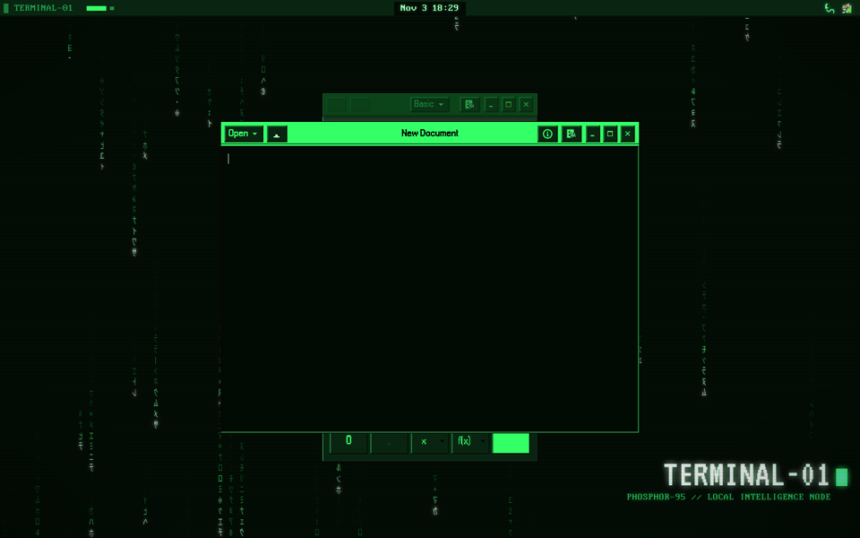
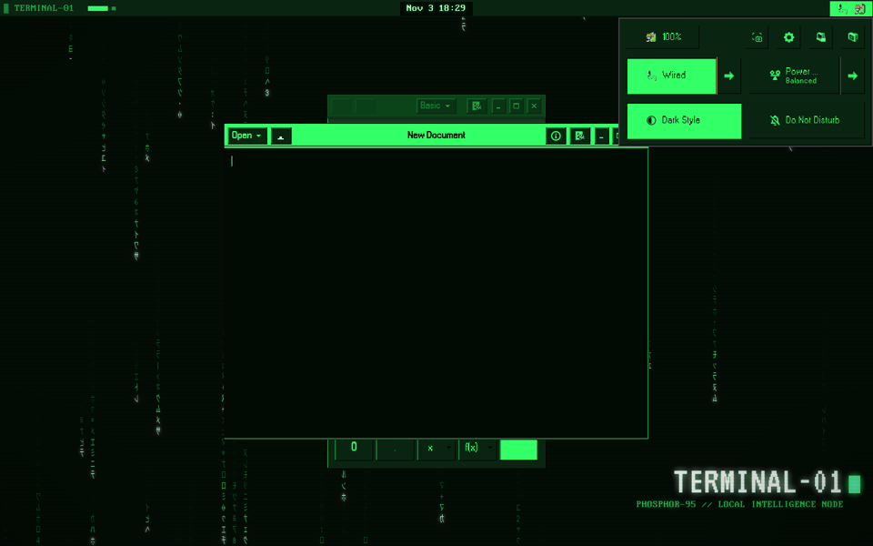
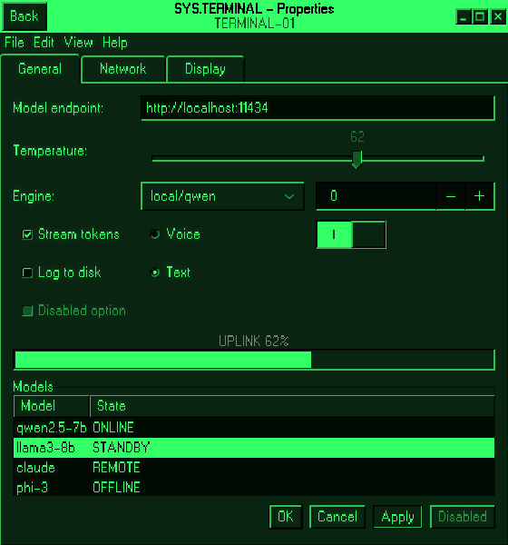
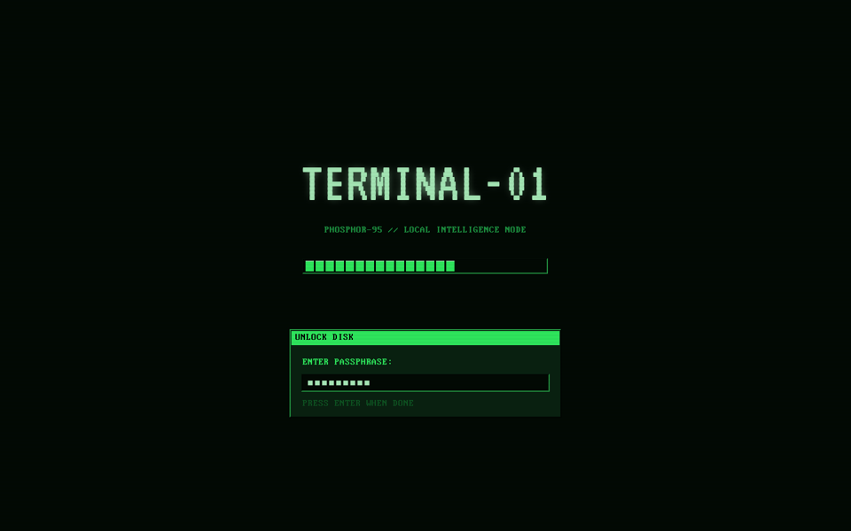
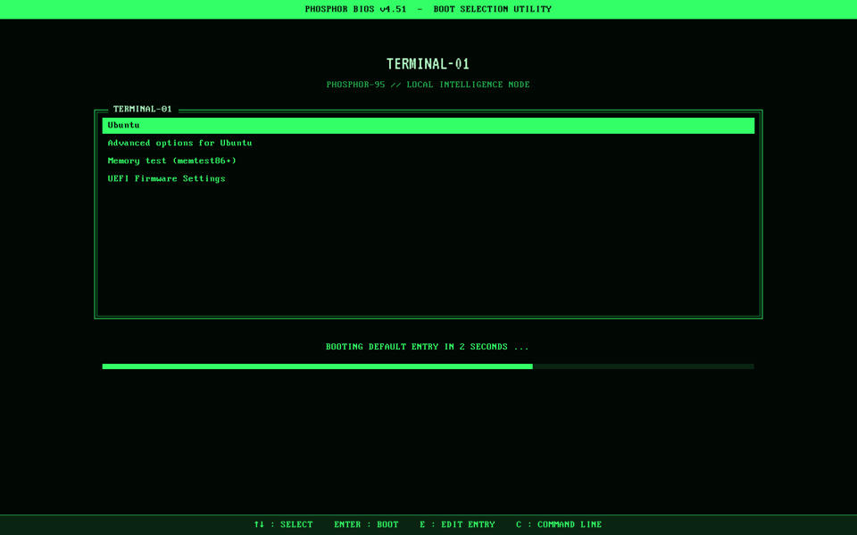

# ▓ PHOSPHOR-95

Windows 95 structure on a green phosphor CRT, with digital rain in the background.
A complete GNOME desktop theme for Ubuntu: GTK, GNOME Shell, icons, cursors, wallpaper,
terminal, login screen, boot splash and GRUB menu, all generated from one palette file.



| | |
|---|---|
|  |  |
|  |  |

## What you get

* **GTK 3/4 + libadwaita**: Win95 bevels, caption bars and pixel fonts, recoloured green.
* **GNOME Shell**: a slim top status bar, a Win95 taskbar at the bottom with a **START** menu, and themed popups, notifications, lock screen and overview.
* **Icons and cursors**: Chicago95, re-tinted to a monochrome green ramp.
* **Wallpaper**: generated digital rain with your machine name in the corner.
* **Terminal**: Ghostty with an optional CRT shader (scanlines, bloom, curvature), zsh, a starship prompt, fastfetch, a btop theme, and a fake BIOS POST banner.
* **Boot**: a GRUB "BIOS boot selection" menu and a Plymouth POST/logo splash.
* **Login**: a matching GDM login screen.

Every part is optional, and everything can be undone.

## Requirements

* **Ubuntu 26.10** (or another Ubuntu with **GNOME Shell 49, 50 or 51** on Wayland). The Shell and GDM themes build on Ubuntu's Yaru theme, so other distros won't work without changes.
* `sudo` access for packages, boot and login screen. Everything else installs in your home directory.

## Install

```bash
git clone https://github.com/Websites-On-Computers/phosphor95.git
cd phosphor95
```

**1. Set your screen resolution and machine name** in `config/system.toml`:

```toml
[identity]
name = "TERMINAL-01"        # shown on the wallpaper, top bar, boot screens and prompt

[desktop]
resolution = "1920x1080"    # your display's native resolution (Settings > Displays)
```

**2. Install packages** (Ghostty, zsh, starship, the official GNOME extensions, build tools):

```bash
sudo ./scripts/install-system.sh packages
```

**3. Build and install the theme for your user** (no sudo):

```bash
./phosphor apply
```

This downloads the pinned upstream sources (the Windows-95 GTK theme and Chicago95), builds everything into `build/`, installs it under `~/.local` and `~/.config`, and switches your GNOME settings over.

**4. Optional system parts** (pick any):

```bash
sudo ./scripts/install-system.sh boot    # GRUB menu + Plymouth boot splash
sudo ./scripts/install-system.sh gdm     # login screen
sudo ./scripts/install-system.sh shell   # make zsh your login shell
```

**5. Log out and back in.** GNOME Shell only loads new themes and extensions at login. Then check everything:

```bash
./phosphor doctor
```

### Before you install: what gets replaced

The user install **overwrites `~/.zshrc`**, and the Ghostty, starship, fastfetch, btop and GTK 4 config files. Any existing file is backed up to `backups/files/<timestamp>/` first and is restored by `./phosphor uninstall`. Put your own shell additions in `~/.zshrc.local`, which is never touched.

It also disables the Ubuntu dock and desktop icons, enables the official `user-theme`, `window-list`, `apps-menu` and `system-monitor` extensions, and binds `Ctrl+Alt+T` / `Super+Return` to Ghostty. The original value of every GNOME setting it changes is saved to `backups/gsettings-revert.txt`.

The full list is in [docs/IMPLEMENTATION.md § 4](docs/IMPLEMENTATION.md#4-install).

## Customise

All colours live in `config/palette.toml`. The name, fonts, resolution and defaults live in `config/system.toml`. After editing either, run:

```bash
./phosphor apply
```

If you changed anything that appears on the boot or login screens (name, colours, resolution), also re-run `sudo ./scripts/install-system.sh boot gdm`.

Some ideas:

* **Amber monitor**: swap the greens in `palette.toml` for ambers (`fg = "#ffb000"` and so on).
* **Rename the machine**: `./phosphor rename MY-BOX` (updates the config and rebuilds).
* **Different fonts**: change `[fonts]` in `system.toml`. The pixel fonts look sharpest at 12 pt (16 px).
* **No CRT effect**: set `crt = false` in `system.toml`, or run `crt off` at any time.
* **No boot banner in the terminal**: `export P95_BANNER=never` in `~/.zshenv` (`always` and `once` are the other options).

## Commands

| Command | What it does |
|---|---|
| `./phosphor apply` | fetch + build + install. Run it after any config change. |
| `./phosphor build [part ...]` | build only (`terminal gtk shell icons cursors wallpaper boot gdm`) |
| `./phosphor install [part ...]` | install only (`fonts themes icons wallpaper terminal shell settings`) |
| `./phosphor rename NAME` | change the machine name everywhere |
| `./phosphor preview [gtk\|boot]` | render preview images to `build/preview/` |
| `./phosphor doctor` | check that everything is installed and working |
| `./phosphor uninstall` | undo the user install |
| `crt on\|off\|toggle` | turn the terminal CRT shader on or off, live |
| `matrix` or `Ctrl+Alt+M` | digital rain screensaver |

## Uninstall

```bash
./phosphor uninstall                         # restore GNOME settings, remove theme files, restore backed-up configs
sudo ./scripts/install-system.sh uninstall   # restore the default GRUB, Plymouth and login screen
sudo chsh -s /bin/bash "$USER"               # only if you switched to zsh
```

Log out and back in afterwards. Keep the `backups/` folder until you've uninstalled: that's where your original settings are.

## Troubleshooting

* **No START button or taskbar after install**: log out and back in. GNOME caches extension code for the whole session. Then run `./phosphor doctor`.
* **Wallpaper looks blurry or misaligned**: `resolution` in `config/system.toml` doesn't match your screen. Fix it and run `./phosphor apply`.
* **Fonts look smeared**: run `./phosphor install fonts` and log out and back in.
* **Some app icons are still colourful**: Chicago95 doesn't cover every modern or snap app ID. Those fall back to the default icons.
* **Login screen looks wrong after a system update**: Ubuntu updated Yaru. Rebuild it with `./phosphor build gdm && sudo ./scripts/install-system.sh gdm`.
* **Something else**: `./phosphor doctor` prints the last GNOME Shell theme errors from the journal.

## How it works

`config/*.toml` is the single source of truth. `tools/build.py` renders the templates in `src/`, recolours the upstream GTK theme and icons, and generates images (wallpaper, boot sprites, GRUB background) into `build/`. The install scripts copy `build/` into place. Nothing in `build/` is hand-edited.

See [docs/IMPLEMENTATION.md](docs/IMPLEMENTATION.md) for the design, the architecture and each component in detail.

## Credits and licenses

This project is licensed under **GPL-3.0** (see [LICENSE](LICENSE)).

* [Windows-95 GTK theme](https://github.com/B00merang-Project/Windows-95) by the B00merang Project (GPL-3.0). The recoloured build ships with its license.
* [Chicago95](https://github.com/grassmunk/Chicago95) icons and cursors by grassmunk and contributors (GPL-3.0 / MIT).
* [The Ultimate Oldschool PC Font Pack](https://int10h.org/oldschool-pc-fonts/) by VileR (CC BY-SA 4.0), [VT323](https://fonts.google.com/specimen/VT323) (OFL) and W95FA (OFL). License files are in `vendor/fonts/licenses/`.
* Design inspiration from [43PR/dotfiles](https://github.com/43PR/dotfiles) (MIT). No code was copied.

Windows 95 is a trademark of Microsoft. This project uses no Microsoft assets and is not affiliated with Microsoft.
