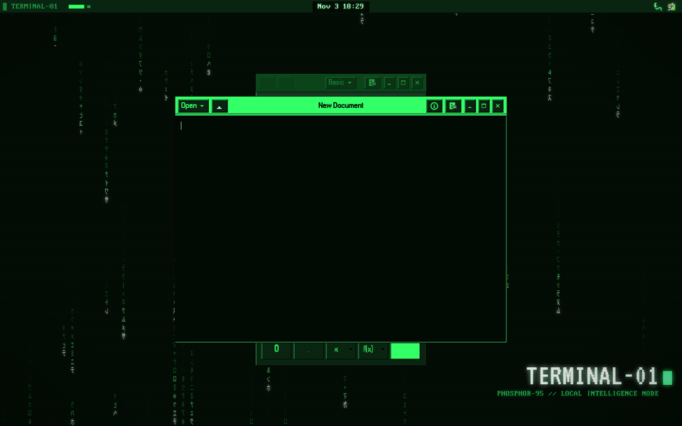
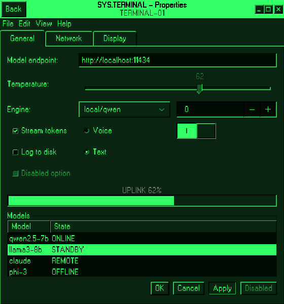
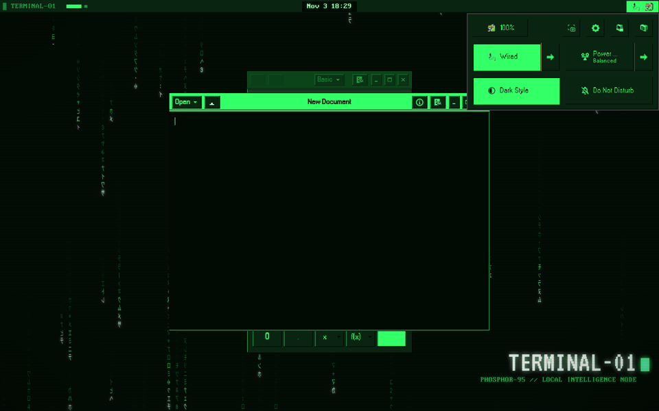
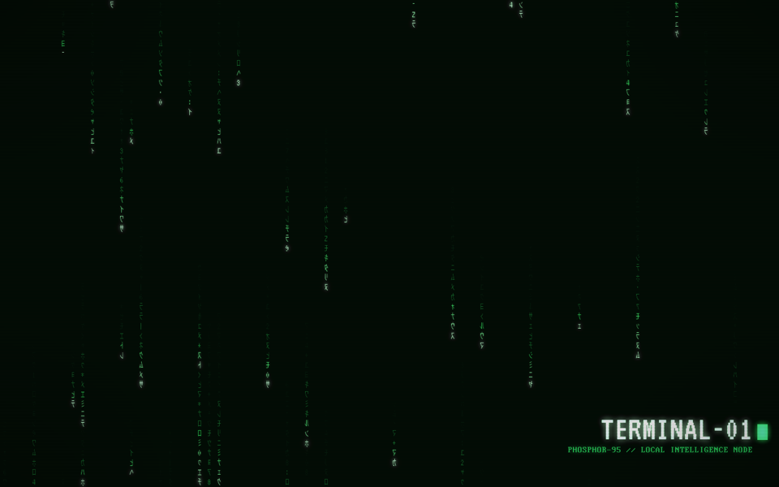
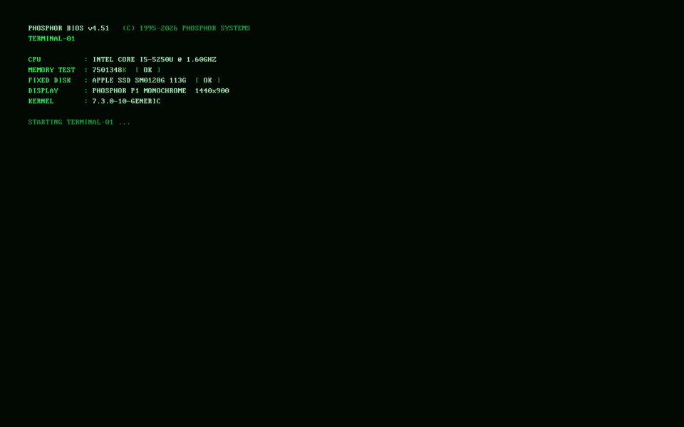
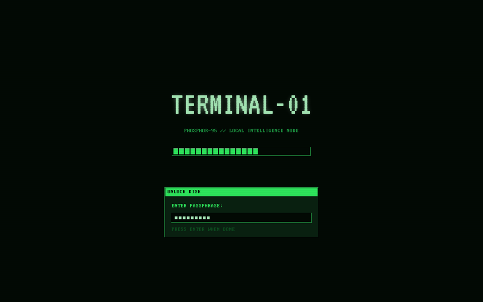
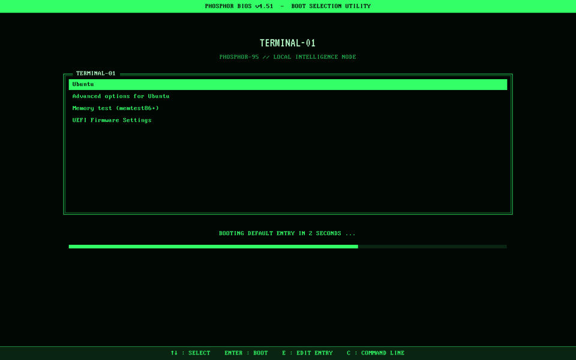

# PHOSPHOR-95: Implementation

> Win95 structure drawn on a green phosphor CRT, with digital rain in the background.
> Design notes and internals. For install steps, see the [README](../README.md).

| | |
|---|---|
| Target | Ubuntu 26.10 · GNOME Shell 49–51 · Wayland |
| Developed on | a 2015-era laptop with Intel integrated graphics, so every effect is kept cheap |



---

## 1. Design

### 1.1 Concept
The theme comes from three references:

1. **Windows 95**, from [B00merang-Project/Windows-95](https://github.com/B00merang-Project/Windows-95): bevelled 3-D controls, caption bars, a bottom taskbar with a START button, pixel UI fonts.
2. **Green CRT terminals**: monochrome phosphor, bright text on dark glass, scanlines, bloom.
3. **[43PR/dotfiles](https://github.com/43PR/dotfiles)**: a monochrome, single-palette discipline in which *every* surface (bar, terminal, prompt, btop, fastfetch) uses one palette file. 43PR does this with Hyprland. Here it is done on GNOME.

**The Matrix** shows up as the digital rain wallpaper (mirrored half-width katakana, as in the film), the `matrix` screensaver, and `#33ff66`-family greens.

**The key move is inverted polarity.** On a green monitor, text glows on dark glass. Every Win95 colour role is mapped accordingly:

| Win95 role | Win95 colour | Phosphor-95 |
|---|---|---|
| window / button face | `#C0C0C0` | `face #0a2412` |
| bevel highlight | `#FFFFFF` / `#DFDFDF` | `bevel_hi #2fbf55` / `bevel_light #1c7a36` |
| bevel shadow | `#808080` / `#000000` | `shadow #041208` / `void #000000` |
| text | `#000000` | `fg #33ff66` |
| text field | `#FFFFFF` | `base #020a04` |
| selection / active caption | navy `#000080`, white text | **inverted**: `#33ff66` bar, black text |
| inactive caption | grey | `#0b4419`, dim text |
| warning / error | n/a | amber-monitor `#ffb000` / `#ff3b3b` |

Light sits top-left and dark bottom-right, so the bevels still read as raised or sunken, just in green.

### 1.2 Decisions
| Area | Choice | Why |
|---|---|---|
| Desktop | Theme **GNOME** (no compositor swap) | Keeps the stock, supported session. Fewer moving parts. |
| Balance | **Phosphor-95 hybrid** | Win95 shapes, CRT palette. |
| CRT effects | **Terminals only** (Ghostty GLSL) | A full-screen shader isn't possible on GNOME, and integrated GPUs have little headroom. |
| Icons | Chicago95, **re-tinted** green | Matches the monochrome monitor premise. |
| GRUB | Themed, **visible 3 s** | Part of the boot sequence. |
| Terminal | **Ghostty + zsh + starship** | Ghostty is the only mainstream terminal with custom GLSL shaders. |
| Name | `TERMINAL-01`, **one config value** | `./phosphor rename NEWNAME` updates everything. |

### 1.3 Typography
| Use | Font | Size | License |
|---|---|---|---|
| UI (GTK, Shell) | **PxPlus IBM VGA 8x16** (int10h) | 12 pt / 16 px | CC BY-SA 4.0 |
| Terminal, clock, banners, GRUB | **PxPlus IBM VGA 9x16** (int10h) | 12 pt / 16 px | CC BY-SA 4.0 |
| Large display (lock clock, splash, wallpaper) | **VT323** | any | OFL |

The UI started on W95FA, but it read as cramped and hard to scan at desktop distance, so the UI now uses the same IBM VGA face as the terminal and the top-bar tag. The 8x16 cut is one pixel narrower per glyph than 9x16, which matters in sidebars and taskbar buttons. W95FA is still installed: set `fonts.ui = "W95FA"` in `config/system.toml` to switch back.

A fontconfig rule (`src/fonts/60-phosphor95.conf`) does two things for **these families only**:
* turns antialiasing and hinting off, so they render as true pixels (glow comes from a faint `text-shadow`, not font blur);
* **blocks faux bold.** None of these faces has a bold weight, so fontconfig's `90-synthetic.conf` would smear them for every `font-weight: bold` (title bars, the focused taskbar button, START). The rule rewrites bold requests to regular in the pattern stage, which runs before `90-synthetic`, so the smear never happens. This covers GTK3, GTK4 and the Shell at once, with no CSS changes.

Use a multiple of the native 16 px (12 pt at 96 dpi). Any other size is resampled and blurs.

---

## 2. Architecture

```
config/palette.toml ─┐   single source of truth (colours)
config/system.toml  ─┤   identity (name, START label, BIOS string) + fonts
                     ▼
            tools/build.py ──► components/*.py ──► build/<component>/   (disposable)
                     ▲                                   │
 .upstream/ (pinned git clones: Win95 GTK, Chicago95)    ▼
 vendor/fonts (fonts + licenses)          scripts/install-user.sh   (no sudo)
 src/ (templates *.tmpl, CSS, scripts)    scripts/install-system.sh (sudo: apt, boot, GDM)
```

* **Templates** use `{{ section.key | filter }}`. Filters: `nohash`, `rgb`, `rgbf` (GLSL), `sgr` (24-bit ANSI), `alpha N`, `mix KEY T`, `upper`, `lower`. See `tools/p95.py`.
* **Everything is generated.** To change a colour, edit `config/palette.toml` and run `./phosphor apply`. No hex value is hand-copied anywhere.
* **Upstream sources are pinned to commits** (`tools/fetch.sh`) and only *read*, never executed.

### 2.1 Repo layout
```
phosphor                  control CLI (build / install / preview / doctor / rename / uninstall)
config/                   palette.toml, system.toml
src/terminal/             ghostty config + CRT shader, zshrc, starship, fastfetch, btop, bin/
src/gtk/                  phosphor additions for GTK3/4, libadwaita override layer
src/shell/                phosphor.css.tmpl (Shell overrides), companion extension
src/boot/                 Plymouth script template
src/fonts/                fontconfig rule
tools/components/         one builder per component (see §3)
tools/preview_*.py        offscreen renderers (GTK3 widgets, boot screens)
tools/shelltest/          headless nested GNOME Shell screenshot harness (§5.2)
scripts/                  install-user.sh, install-system.sh, uninstall.sh
vendor/fonts/             fonts + licenses
docs/                     this file + img/
```

---

## 3. Components

### 3.1 GTK theme: `Phosphor95` (`tools/components/gtk.py`)
Fork of B00merang Windows-95 (GPL-3), recoloured **by CSS property role**. A plain hex swap is impossible because Win95 reuses colours across roles: `#FFFFFF` is both a field fill and a bevel highlight, and `#000000` is both text and a shadow. Each colour literal is classified by the property it sits in:

* `color`, `caret-color` → **text** roles (dark→`fg`, light→`select.fg`, blue→`glow`)
* `background*` → **fill** roles (white→`base`, grey→`face` ramp, navy→`select.bg`)
* `border*`, `box-shadow`, `outline` → **edge** roles (white→`bevel_hi` … black→`void`)
* saturated hues → `warn` / `error` / `ok`

The `@define-color` block is rebuilt with semantic values. Pixel-art assets (checkboxes, radios, sliders, title-bar glyphs) are recoloured with a **spatial rule**: pixels ≥2 px deep inside the opaque shape are content (field fill, check mark), and rim pixels are bevel. A thin layer (`src/gtk/phosphor-gtk-*.css.tmpl`) adds the faint text bloom, inverted selection, and tooltips.

**libadwaita** ignores `gtk-theme`, but it loads `~/.config/gtk-4.0/gtk.css`. `src/gtk/libadwaita.css.tmpl` sets the libadwaita 1.10 CSS variables (`--window-bg-color`, `--accent-bg-color`, …) and adds Win95 bevels, square corners, and an inverted caption bar (dim when the window is in the background).



### 3.2 GNOME Shell theme (`src/shell/phosphor.css.tmpl`)
Loaded by the official `user-theme` extension. It **`@import`s Ubuntu's Yaru-dark** stylesheet and layers overrides on top, so anything not restyled stays functional across GNOME updates. Restyled areas:

* **Top bar = slim status HUD**: `▓ TERMINAL-01` tag, square LED workspace dots, a recessed LCD clock, live CPU/MEM/NET from the official `system-monitor` extension.
* **Bottom taskbar** (official `window-list`): Win95 task buttons, raised by default and sunken plus glowing when focused.
* **START button**: the official `apps-menu` (a categorised Win95-style menu), relabelled and docked at the left of the taskbar.
* Popups, quick settings, calendar, notifications (Win95 dialogs with green caption bars), modal dialogs (Run, power, polkit), OSD, Alt-Tab, overview, lock screen (96 pt VT323 clock), screenshot UI.

St CSS gotchas learned (and handled): St allows one `box-shadow`, so bevels use **per-side border colours**. There's no `:not()`. Yaru uses `!important` on `#panel` and the workspace dots. The window-list taskbar is *also* named `#panel` (scoped with `#panel.bottom-panel`). Extension stylesheets load after the theme, so overrides of `window-list` use `!important`.



### 3.3 Companion extension: `phosphor95-shell@terminal01`
A small extension (≈150 lines, `src/shell/extension/`) that CSS alone can't replace:
1. relabels the apps-menu button as **START** and adds a terminal logo,
2. **moves it into the window-list taskbar** (bottom-left, like Win95) and re-docks it if the taskbar is rebuilt (monitor change, extension reload),
3. adds the `▓ TERMINAL-01` HUD tag to the top bar.

It only uses the official extensions, so there are no third-party extensions to break on GNOME upgrades. It also ships `stylesheet.css` with the **taskbar rules**. St ranks extension stylesheets above the shell theme, even over `!important`, so window-list's own colours (the grey `#5b5b5b` focused button, the white workspace previews) can only be overridden from another extension. Its selectors carry a `.bottom-panel` prefix to win on specificity.

**Lifecycle rules (these once caused real Shell crashes).** START is apps-menu's actor living inside window-list's tree, and GNOME enables user extensions *before* system ones. So when the screen locks, or any of the three is disabled, window-list tears down its taskbar first. The old code let the START button be destroyed with the taskbar, then apps-menu and this extension both touched the dead actor and Clutter segfaulted. The rules now are:
* a `destroy` handler on the taskbar box hands START back to the top bar *before* Clutter destroys the box's children;
* a `destroy` handler on apps-menu's button drops every reference, and nothing touches it again;
* re-docking is driven by `child-added` on the top bar and on `uiGroup`, so START comes back after unlock;
* the button's container gets an explicit `x_expand = false` (panel buttons are created expanding, which would let START swallow the taskbar's spare width);
* nothing is restored during Shell shutdown.

GNOME Shell caches an extension's JavaScript for the whole login session. After updating this extension, **log out and back in before enabling it**. Toggling it in a running session still runs the old code.

### 3.4 Icons and cursors
* **Icons**: Chicago95 (GPL-3/MIT) re-tinted. PNGs go luminance → 5-stop ramp `#04170a → fg_faint → fg_dim → fg → glow`. SVG colour literals are rewritten the same way. `*-symbolic` icons are untouched because GTK/St recolour them at runtime. The ramp's floor is faint green rather than black, so Win95's black outlines stay visible on the dark desktop (see `img/icon-tint-study.png`).
* **Cursors**: Chicago95 *Standard* (white Win95 arrow) recoloured **inside the compiled Xcursor files** (header/TOC parse, un-premultiply, map, re-premultiply). This needs no `xcursorgen`. 184 cursors, animated hourglass included.

### 3.5 Wallpaper (`tools/components/wallpaper.py`)
Generated and deterministic (seeded): near-black glass with a faint centre glow, sparse digital rain (mirrored katakana from Noto Sans Mono CJK, plus VT323 digits) with hot heads and two-stage bloom, scanlines on native device rows, a vignette, and the `TERMINAL-01` mark with a block cursor above the taskbar. The **login** variant fades the rain behind the centred dialog. It is rendered at `[desktop] resolution` from `config/system.toml`.



### 3.6 Terminal stack (`src/terminal/`)
| Piece | Notes |
|---|---|
| **Ghostty** | IBM VGA 9x16 at 12 pt (native px), palette from `[ansi]`, `window-theme = ghostty` so the chrome matches. Keybind `Ctrl+Shift+M` types `matrix`. |
| **CRT shader** `phosphor-crt.glsl` | Barrel curvature 0.03, 2 px scanlines, 8-tap bloom on bright pixels only, vignette, rounded tube corners. **1 + 8 texture taps, no animation loop** (`custom-shader-animation = false`), so it only redraws when the terminal does. Toggle live: `crt on|off|toggle` (edits the managed block and sends `SIGUSR2` to reload). |
| **zsh** | history, completion, autosuggestions, syntax highlighting, all in palette colours. Personal additions go in `~/.zshrc.local`. |
| **starship** | ASCII/CP437 only (no Nerd Font): `┌─[user@TERMINAL-01]─[~/dir]─[git:main*]` / `└─>`. |
| **p95-boot** | First terminal per login session: a POST readout of **real** facts (CPU, RAM count-up, disk, IP, detected model host: ollama / llama.cpp), then fastfetch. Any key skips. `P95_BANNER=always|once|never`. |
| **fastfetch** | CRT-monitor ASCII logo carrying the system name; `SYS.*` / `HW.*` / `NET.*` keys. |
| **btop** | `phosphor95` theme. |
| **matrix** | `cmatrix` screensaver. `Ctrl+Alt+M` opens it fullscreen in Ghostty. |

### 3.7 Boot: Plymouth + GRUB (`tools/components/boot.py`)
**Plymouth** runs from the initramfs, which only ships Ubuntu's fonts, so **all styled text is pre-rendered to PNGs** in the IBM VGA font at build time. The script (`src/boot/phosphor95.script.tmpl`) only places sprites, at 50 fps:
1. POST lines type in: `PHOSPHOR BIOS v4.51`, CPU, **live memory counter** (digit sprites), disk, display, kernel.
2. Fade to the **TERMINAL-01** logo with bloom and a **segmented Win95 progress bar** (tracks real boot progress, with a time-based floor).
3. A Win95 **UNLOCK DISK** dialog with bullets for LUKS prompts. fsck/status messages use the initramfs font.
4. Shutdown/reboot shows the logo and `SHUTTING DOWN TERMINAL-01 ...`.

The script avoids `%`, ternaries and implicit globals, because Plymouth's script language is minimal.

**GRUB**: a "BIOS boot selection utility" background (caption bar, double-line frame, key-help footer, scanlines) drawn at the same percentage geometry as `theme.txt`, `.pf2` fonts compiled from the IBM VGA and VT323 TTFs, an inverted selection bar, and a countdown label plus thin progress bar. `GRUB_TIMEOUT=3`, `GRUB_GFXMODE=<resolution>,auto`, `GRUB_GFXPAYLOAD_LINUX=keep` (clean hand-off to Plymouth).

| | |
|---|---|
|  |  |



### 3.8 Login screen (GDM)
`tools/components/gdm.py` extracts Ubuntu's Yaru shell gresource, appends the Phosphor overrides to each stylesheet, embeds the login wallpaper, and recompiles. It is installed through **`update-alternatives gdm-theme.gresource`**, Ubuntu's own switch, so reverting is one command and package updates don't overwrite it.

---

## 4. Install

Step-by-step install, everyday commands and rollback are in the [README](../README.md). This section only lists exactly what gets changed.

### 4.1 What the user install changes
* Files go under `~/.local/share/{themes,icons,fonts,backgrounds,gnome-shell/extensions}`, plus `~/.config/{ghostty,fastfetch,btop,gtk-4.0,fontconfig}`, `~/.config/starship.toml`, `~/.zshrc`, and `~/.local/bin/{p95-boot,crt,matrix}`.
* gsettings: GTK, icon and cursor theme; fonts; dark scheme; green accent; wallpaper plus lock screen; button layout; extensions (Ubuntu dock off; user-theme, window-list, apps-menu, system-monitor and phosphor95-shell on); keybindings `Ctrl+Alt+T` / `Super+Return` → Ghostty, `Ctrl+Alt+M` → matrix.
* **The original value of every gsettings key is recorded once** in `backups/gsettings-revert.txt`. Any pre-existing config file that gets replaced is copied to `backups/files/<timestamp>/`.

---

## 5. Verification

GNOME blocks screenshots from unprivileged tools, so verification is built in.

### 5.1 Offscreen renders (`./phosphor preview`)
* **GTK3**: `tools/preview_gtk3.py` builds a widget gallery (headerbar, menubar, tabs, entry, scale, combo, spin, check, radio, switch, progress, tree view with selection, buttons in every state) in a `Gtk.OffscreenWindow`, in focused and backdrop states.
* **Boot**: `tools/preview_boot.py` composites the actual Plymouth sprites at the script's coordinates (POST frame, logo frame with dialog) and the GRUB screen.

### 5.2 Headless GNOME Shell harness (`tools/shelltest/run.sh OUT [apps…]`)
Starts a **real gnome-shell 51** (`--headless --virtual-monitor <resolution> --mode=ubuntu`) on a **private D-Bus** with its own `XDG_DATA_HOME`, `XDG_CONFIG_HOME` and dconf database, so it never touches the live session. A test-only extension (`p95-testkit@local`) loads the stylesheet, walks scripted scenes (desktop, START menu, quick settings, calendar, notification, Run dialog, overview, app grid) and saves a PNG of each through `Shell.Screenshot`. Optional apps (for example `gnome-text-editor`) open as real windows for checking title bars and the taskbar.

> Ubuntu 26.10 uses dbus-broker, which can't spawn a standalone bus without systemd. The harness downloads the official `dbus-daemon` .deb with `apt-get download` and unpacks it locally to get `dbus-run-session`. Nothing is installed system-wide.

**Lifecycle test.** After the scenes, the kit runs the paths that crash a Shell: it simulates a lock by pushing the `unlock-dialog` session mode (the same path a real lock takes), disables and re-enables phosphor95-shell, window-list and apps-menu, then locks again. It logs each extension's state, where START ended up, and START's actor sizes, and a crash shows up as a missing `DONE`. The old extension dies on the first lock; the current one passes with zero Gjs warnings. Skip it with `P95_TEST_LIFECYCLE=0`. `tools/shelltest/popover-test.py` is a test window that pops its title-bar menu open, so menu colours can be checked.

Issues the harness caught and fixed: Yaru's `!important` top-bar colour, Yaru's 100 px inset hover shadows, the white workspace dots, a libadwaita backdrop title bar overridden by our own selector specificity, and a wrong preview font sandbox.

### 5.3 What the harness can't cover
| Item | Why it can't be done headless |
|---|---|
| Ghostty CRT shader look and performance | needs Ghostty, plus your eyes on the real panel |
| Lock screen *look* | needs a logind session (lock *survival* is covered by the lifecycle test) |

---

## 6. Known limitations
* **Snap / modern app icons** (Firefox snap, App Center, `org.gnome.*` IDs) aren't covered by Chicago95 and fall back to colourful Adwaita. An alias map (app-id → Chicago95 icon) would fix most of them.
* **No full-screen CRT on GNOME**, by design (§1.2). Terminal-only via Ghostty.
* **Libadwaita apps** get colours, bevels and captions through the user CSS layer, not a full Win95 restyle. That layer is officially unsupported and may need touch-ups on libadwaita bumps.
* **GDM theme** is rebuilt from Yaru's gresource. After a Yaru update, re-run `./phosphor build gdm && sudo ./scripts/install-system.sh gdm`.

## 7. Credits and licenses
* Windows-95 GTK theme: B00merang Project, **GPL-3.0**. The recoloured derivative ships with its LICENSE.
* Chicago95 icons and cursors: grassmunk et al., **GPL-3.0+/MIT**.
* W95FA (OFL), VT323 (OFL), Ultimate Oldschool PC Font Pack by VileR / int10h (**CC BY-SA 4.0**). License files are in `vendor/fonts/licenses/`.
* 43PR/dotfiles (MIT) was used as design reference only. No code was copied.
